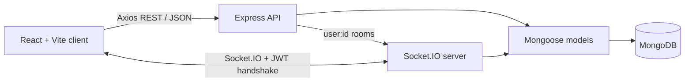

# Architecture

## Components

- **Frontend:** React routes render authentication, team exploration, dashboard, portfolio, smart matches, chat, and notification UI. `AuthContext`, `SocketContext`, and `ThemeContext` hold cross-cutting client state.
- **Backend:** Express exposes JSON APIs, applies security middleware, mounts feature routes, and creates the HTTP server used by Socket.IO.
- **Database:** Mongoose models persist users, teams, join requests, conversations, messages, and notifications in MongoDB.
- **Authentication:** HTTP requests use the existing `protect` middleware. Socket handshakes independently verify the same JWT.

## Data flow examples

1. A user submits a join request through REST. Express validates it, writes a `Request`, emits a Socket.IO request event, and creates a persisted notification for the team creator.
2. A creator accepts through REST. A conditional MongoDB update adds the requester only if a seat remains; the request becomes accepted; the applicant receives a real-time event and notification.
3. A chat sender uses Socket.IO or the REST message endpoint. The server derives sender/receiver from authenticated membership, persists `Message`, updates `Conversation`, and emits the message and notification.

REST remains the source of truth for reloads and offline clients. WebSockets avoid repeated polling for state that can arrive immediately.
